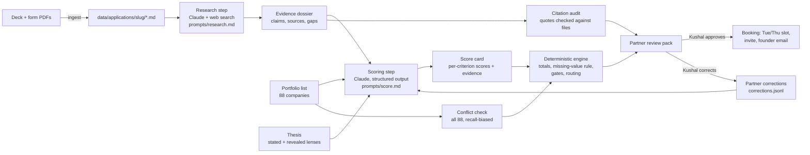

# All In Capital — intake triage

A system that takes a week of inbound applications, the whole pile, and returns a
read on each one for the partners:

- **A score against the fund's thesis, criterion by criterion.** Every score names
  the criterion it is scored against and the sources behind it.
- **What it couldn't find out.** Each gap comes with the question to put to the founder.
- **Whether to take the call.** This is a suggestion only. Kushal sees every outcome
  before anything is decided.

It then removes the busywork around a yes, and it keeps the partners' corrections
so they count the next time a similar company comes in. Before any of it touches a
real decision, it is measured against the fund's own past calls.

Built for MESA T2 Case 03 (All In Capital). The case brief and the seed data are in
`data/seed/` and `data/applications/`.

> **Read first:** [`docs/WRITEUP.md`](docs/WRITEUP.md) has the results, the backtest,
> the trust contract and the known limits.
> The partner review pack is at `runs/<date>/report.html`.

## How a week of intake flows



**Who does what:**
- **Claude does judgement only:** it gathers evidence and scores each criterion with
  sources.
- **Code does all arithmetic and routing:** weighting, the missing-value penalty,
  gates and thresholds live in `triage/core.py` and `data/fund/thesis.json`. Partners
  can read them, and they apply the same way to every company.

## Repository map

| Path | What it is |
|---|---|
| `data/fund/thesis.json` | The thesis, as two lenses: **stated** (public wording, with source URLs) and **revealed** (reconstructed from the 12 memos and 5 partner meetings). Also holds the gates and routing thresholds. |
| `data/fund/public_thesis.json` | Every public statement about the fund's thesis, each with URL and verbatim quote, plus what could not be found. |
| `data/fund/portfolio.json` | 88 portfolio companies from the fund's own portfolio CSV, press and Tracxn, with sources. Pre-fund partner investments are marked. |
| `data/fund/corrections.jsonl` | Partner corrections, seeded with the four found in the meeting notes. |
| `data/applications/<slug>/` | The 10 inbound applications as deck and form text, transcribed verbatim. |
| `data/research/<slug>.json` | Evidence dossier per applicant: claims, sources, gaps, contradictions. |
| `data/scores/<slug>.json` | Per-criterion score card per applicant. |
| `data/backtest/` | Blind inputs built from the 12 memos, score cards, `results.json` and the adjudication of each disagreement. |
| `prompts/` | The two prompts used by the API path and by the in-session run. |
| `triage/` | The pipeline. |
| `tests/` | Tests for the deterministic parts. |
| `runs/<date>/` | `batch.json`, `report.html`, and the outbox (invites, founder emails, pass notes). |

## Running it

```bash
pip install -r requirements.txt
```

The research and scoring steps need an Anthropic credential:

```bash
export ANTHROPIC_API_KEY=...
```

Score every application in `data/applications/` and write the review pack. Existing
dossiers and score cards are reused:

```bash
python -m triage run
```

Re-research and re-score from scratch:

```bash
python -m triage run --refresh
```

**Partner actions.** Nothing is booked or sent until these are recorded:

```bash
python -m triage approve pumpwise call --by Kushal
```

```bash
python -m triage approve talkbook hold --by Kushal --note "speak to MeetRecord founder first"
```

```bash
python -m triage correct grainkind R3 3.5 --by Kushal --reason "31-38% 90-day repeat is good but LTV/CAC 1.8x means growth is still partly bought" --tags consumer_brand,d2c,paid_growth
```

Book what was approved. This holds Tue/Thu afternoon slots, writes the `.ics` invites
and founder emails, and drafts pass notes:

```bash
python -m triage book
```

Backtest against the fund's 12 past decisions:

```bash
python -m triage backtest
```

See what booking produces without any real decisions (writes `runs/<date>/demo_outbox/`, labelled as a demo):

```bash
python scripts/demo_week.py
```

Other commands:

```bash
python -m triage audit
```

```bash
python -m triage ingest new_deck.pdf --slug newco --kind deck
```

```bash
python -m pytest -q
```

## How this batch was produced

This environment had no Anthropic API key, so the research and scoring steps for
this batch and the backtest were run in a Claude Code session instead of through
`triage/llm.py`.

- **Same prompts:** each step was run by an agent following the same prompt text in
  `prompts/`.
- **Real web research:** the agents used live web search and fetch.
- **Same contracts:** outputs were written in the same schemas and checked by the
  same validators and citation audit.
- **Labelled:** every file records this in its `produced_by` field.

The deterministic engine, conflict check, scheduling, report and backtest arithmetic
ran as code. Running `python -m triage run --refresh` with a key regenerates
everything through the API.
