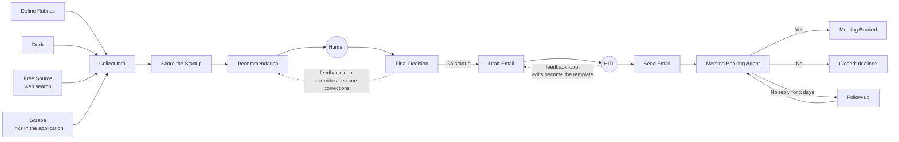

# All In Capital — intake triage

A system that takes a week of inbound applications, the whole pile, and runs each one
through the pipeline on the whiteboard:

- It defines the rubric, collects information, scores the startup, and recommends.
- A partner makes the final decision.
- For a Go, it drafts the invite. A person reviews it, then it is sent.
- A booking agent reads the founder's reply and books the meeting, closes the thread,
  or follows up.

Built for MESA T2 Case 03 (All In Capital). The case brief and seed data are in
`data/seed/` and `data/applications/`.

> **Read first:** [`docs/WRITEUP.md`](docs/WRITEUP.md) has the results, the backtest,
> the trust contract and the known limits.
> The review pack is at `runs/<date>/report.html`. A full simulated walk through every
> box is in `runs/demo/transcript.txt`.

## The pipeline



| Whiteboard box | Command | Code |
|---|---|---|
| Define Rubrics | `python -m triage rubric` | `flow.define_rubrics`. Validates `data/fund/thesis.json` (two lenses, gates, routing) and snapshots the version every score refers to. |
| Collect Info: Deck | (in `collect`) | `ingest.py`. Deck/form PDF to text, or the transcribed `.md`. |
| Collect Info: Free Source | (in `collect`) | `llm.research`. Claude with web search/fetch, following `prompts/research.md`, produces the evidence dossier. |
| Collect Info: Scrape | (in `collect`) | `scrape.py`. Fetches every link in the deck and form. A live page becomes a source; a dead, placeholder or bot-walled link becomes a named gap. |
| Score the Startup | `python -m triage score` | `llm.score`. Per-criterion scores with cited evidence (`prompts/score.md`). |
| Recommendation | `python -m triage recommend` | `core.decide`. Deterministic totals, the missing-value rule, the four gates, the portfolio conflict check and the routing thresholds. |
| Boxes 1–4 for the whole pile | `python -m triage run` | Also writes the review pack. |
| Human → Final Decision | `python -m triage decide <slug> go\|no_go\|hold --by Kushal [--reason "..."]` | `flow.final_decision`. Nothing moves without it. |
| Feedback loop 1 | (automatic) | Overriding the recommendation requires a one-line reason. That reason is stored as a correction (`corrections.jsonl`), which the scorer retrieves for similar companies. |
| Draft Email | `python -m triage draft <slug> [--to email]` | `flow.draft_email`. Offers 3 free Tuesday/Thursday afternoon slots, spread across days, never offered to another founder at the same time. Aditya is included for deeptech. |
| HITL | `python -m triage review <slug> --by Riya [--body-file edited.txt] [--note "..."] [--save-template] [--reject]` | `flow.review_draft` |
| Feedback loop 2 | (in `review`) | Edits and notes are logged (`email_feedback.jsonl`). With `--save-template`, the edited email becomes the template for the next draft. Notes are shown to the next reviewer. |
| Send Email | `python -m triage send <slug>` | `emailer.py`. Writes a real `.eml` to `runs/outbox/` by default; `EMAIL_BACKEND=smtp` sends it. |
| Meeting Booking Agent | `python -m triage agent` (run hourly) | `flow.booking_agent` and `replies.py`. Reads replies (local inbox or IMAP), matched by the `[AIC-slug]` tag in the subject. |
| → Yes | | Books the chosen slot in the calendar (local file or Google Calendar) and sends a confirmation with an `.ics` invite. |
| → No | | Closes as declined. |
| → Asks for other times | | Offers new slots, skipping the ones already offered and any week the founder says they're busy. |
| → No reply for x days | | Sends a follow-up after `follow_up_after_days` (default 3), up to `max_follow_ups` (default 2), then closes. |
| → Unclear | `python -m triage resolve <slug> yes\|no\|reschedule --by Riya` | Never guesses; a person decides. |
| Where is everyone | `python -m triage status` | `data/pipeline/state.json` keeps every stage change with time, actor and detail. |

**Who does what:**
- **Claude does three judgement tasks:** research, per-criterion scoring, and reading
  founder replies. Reading replies falls back to transparent rules when no API key is set.
- **Code does all arithmetic, routing, gating, scheduling and state.**
- **People own the two gates:** the final decision and the draft review.
- **Stages can't be skipped.** You can't draft before a decision or send before review.

## Deployed app (Vercel)

**Live:** https://all-in-capital-intake-amitharaogs-projects.vercel.app

The web app is the same pipeline with buttons.

**Pages:**
- `/`: the whiteboard with a count at every box, and the queue.
- `/c/<slug>`: one company. It has an action panel for its current stage, the email
  thread, the founder replies, the stage history and the full scored dossier.
- `/report`, `/writeup` and `/demo`: the review pack, the write-up and the demo
  transcript.

**Access:**
- **Viewing is public.** Anyone with the link can read every page.
- **Actions need the desk passcode** (the `APP_PASSCODE` environment variable).
  Actions are: decide, draft, review, send, simulate a reply, run the agent, the demo
  clock, and reset.

**What the deployed demo does and doesn't do:**
- **No real mail.** Emails land in an outbox inside the app.
- **Founder replies are simulated** on each company page.
- **The demo clock** moves time forward, so you can watch the follow-ups fire.
- **Reset** puts every application back at Recommendation.

**How it runs:**

| Part | Detail |
|---|---|
| Entry point | `app.py`, a FastAPI app that Vercel detects automatically. Region `sin1`. |
| State | Neon Postgres project `all-in-capital-triage`, table `docs`, reached over Neon's HTTPS SQL endpoint (`triage/storage.py`). A key that isn't in the table falls back to the seed file in the repo. |
| Booking agent | Runs daily at 09:00 IST (`vercel.json` cron, authorised by `CRON_SECRET`). Hobby plans allow daily jobs only. There is also a "Run booking agent now" button. |
| Environment variables | `DATABASE_URL`, `APP_PASSCODE`, `CRON_SECRET`, `SESSION_SECRET`. All are marked sensitive in Vercel. |
| Research and scoring | Not run on Vercel. The deployment ships the dossiers and score cards produced for this batch. Run `python -m triage run --refresh` locally with an API key, then commit, to update them. |

## Running it

```bash
pip install -r requirements.txt
```

The research and scoring steps call Claude through this key:

```bash
export ANTHROPIC_API_KEY=...
```

Boxes 1–4 for every application, plus the review pack:

```bash
python -m triage run
```

Then, per company:

```bash
python -m triage decide pumpwise go --by Kushal
```

```bash
python -m triage draft pumpwise --to founder@pumpwise.com
```

```bash
python -m triage review pumpwise --by Riya
```

```bash
python -m triage send pumpwise
```

On a schedule, for example hourly:

```bash
python -m triage agent
```

See every box run end to end on a sandbox copy, with simulated decisions, replies and
clock. It writes `runs/demo/`:

```bash
python scripts/demo_pipeline.py
```

Other commands:

```bash
python -m triage correct grainkind R3 3.5 --by Kushal --reason "..." --tags consumer_brand,d2c
```

```bash
python -m triage backtest
```

```bash
python -m triage audit
```

```bash
python -m pytest -q
```

### Configuration

| What | Where |
|---|---|
| Follow-up timing, slots offered, minimum notice | `data/fund/pipeline.json` (defaults: 3 days, 2 follow-ups, 3 slots, 20 h notice) |
| Partners' availability | `data/fund/calendar.json`, or set `GOOGLE_CALENDAR_ID` and `GOOGLE_ATTENDEE_CALENDARS` with `GOOGLE_APPLICATION_CREDENTIALS` |
| Sending | `EMAIL_BACKEND=smtp` with `SMTP_HOST`, `SMTP_PORT`, `SMTP_USER`, `SMTP_PASSWORD`, `EMAIL_FROM` |
| Reading replies | `INBOX_BACKEND=imap` with `IMAP_HOST`, `IMAP_USER`, `IMAP_PASSWORD`. Locally, drop replies in `data/pipeline/inbox/<slug>/` |
| Email wording | `data/fund/email_templates/` (created when a reviewer saves an edit as the template) |

## Repository map

| Path | What it is |
|---|---|
| `data/fund/thesis.json` | The rubric: **stated** lens (public wording, with source URLs) and **revealed** lens (reconstructed from the 12 memos and 5 partner meetings), plus gates and routing thresholds. |
| `data/fund/public_thesis.json` | Every public statement about the thesis, each with URL and verbatim quote, plus what could not be found. |
| `data/fund/portfolio.json` | 88 portfolio companies with sources, used by the conflict check. |
| `data/fund/corrections.jsonl` | Partner corrections and decision overrides (feedback loop 1). |
| `data/applications/<slug>/` | The 10 inbound applications as deck and form text, transcribed verbatim. |
| `data/research/<slug>.json` | Evidence dossier: claims, sources, gaps, contradictions. `research/scrape/` holds the raw scrape results. |
| `data/scores/<slug>.json` | Per-criterion score cards. |
| `data/pipeline/state.json` | Where every application is on the whiteboard, with full history. |
| `data/backtest/` | Blind re-scoring of the fund's 12 past decisions, with adjudication. |
| `prompts/` | The research and scoring prompts. |
| `triage/` | The pipeline code. |
| `tests/` | Tests for the engine and for every whiteboard branch, run through the CLI on a sandbox. |
| `runs/` | Review packs, outbox `.eml` files, and the demo. |

## How this batch was produced

This environment had no Anthropic API key, so the research and scoring steps for the
10 applications and the backtest were run in a Claude Code session instead of through
`triage/llm.py`.

- **Same prompts and inputs:** the agents followed the same prompt files and input
  packets.
- **Real web research:** they used live web search.
- **Same contracts:** outputs were written in the same schemas and checked by the same
  validators and citation audit.
- **Labelled:** every file records this in its `produced_by` field.

Everything after scoring ran as code: Recommendation, the decision gate, drafting, the
review step, sending to the outbox, the booking agent with the rule-based reply reader,
and calendar booking.

To regenerate everything through the API once a key is set:

```bash
python -m triage run --refresh
```

Real sending, inbox reading and Google Calendar booking need their credentials and have
not been exercised here.
